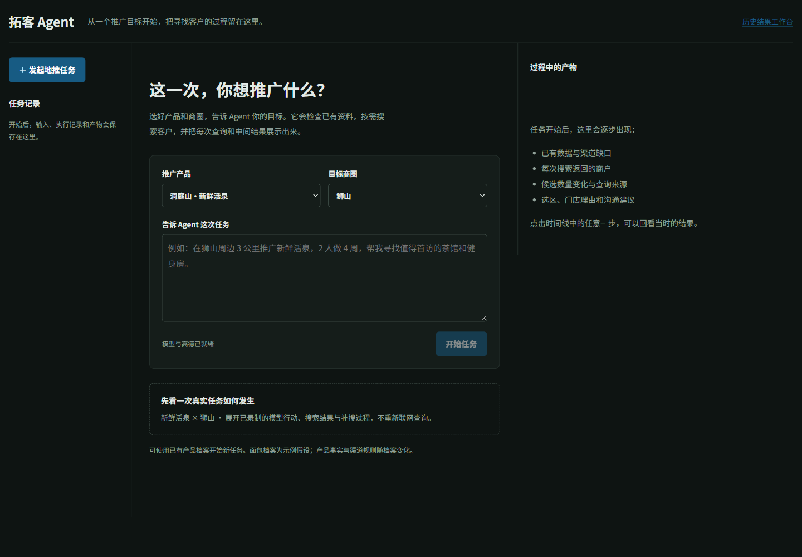
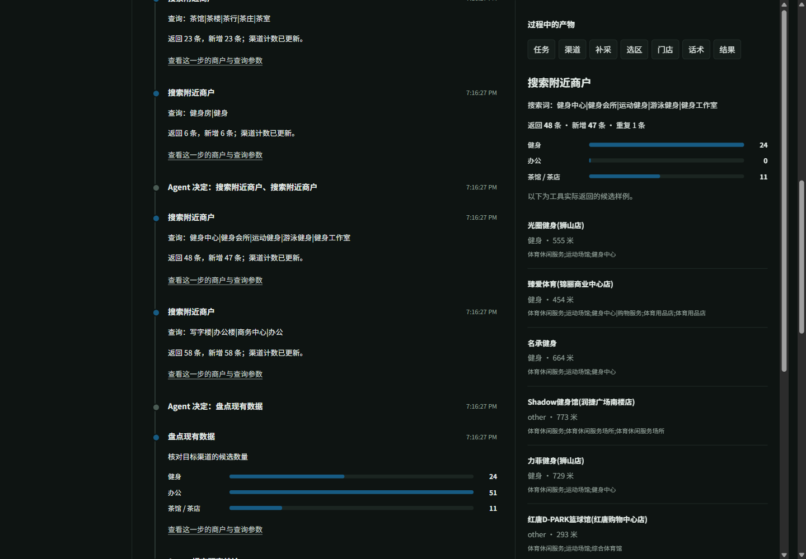

# 从页面开始一个地推任务

当前主入口采用用户提供的 `Way2AGI-agent-workbench.zip` 中的工作台前端，地址为 `http://127.0.0.1:5174/agent-workbench.html`；原 `#/agent` 入口自动跳转。保留任务记录、九个关卡、百宝箱和右侧地图/决策/名单/话术，接入本地真实任务 API。历史按需加载，离线录制与在线执行明确区分。

连续对话：一次新建任务对应左侧一条记录；补充要求在当前对话追加用户消息，保留前几轮的结果和可展开工具记录。后台每轮仍保存独立 run 和 parent_id，以便保留失败与重试证据；刷新页面时按 parent_id 合并历史，恢复到最近一轮。右侧面板显示最近一轮产物。

人数、周期是可选的排期信息，不再作为启动策略分析的必填项。仅描述产品、商圈和范围即可生成渠道策略、客户名单、话术及证据；缺少排期信息时，原字段保持 `null`，`pack.days` 为空，A/B 级客户全部保留在 `pack.backlog`，页面显示「人员排期待安排」。已有明确参数沿用，后续明确修改时使用新值；不擅自填入人数、周期或人日。已提供参数的正数、容量和路线复算检查继续生效。

验证：`tests/test_pipeline.py` 新增缺人数、缺周期、两者都缺的完整流水线用例，以及拒绝虚构人数/无效人数用例。与对话和任务回归共 139 项通过。实况输入「在狮山周边3公里推广新鲜活泉，先分析客户和拓客策略」执行完成（本地 run `e3aad4065f98499a9fa943c1655a24e3`），人数与周期为 null、questions 为空、days 为空，planning_note 明确排期待安排。

2026-10-24 回归：原先缺人数/周期的任务追加「2个人，做4周」后完成全部关卡，再追加「把半径改成 2 公里，3 个地推，做 6 周」，实际 brief 更新为 2000 米、3 人、6 周并再次完成。浏览器对话条目数量保持不变，消息连续保留；刷新可恢复。修复了「覆盖 3km」「2个人」「半径改成」不识别、追加参数读取旧值的问题；仅有一个数值待补项时，裸数字按该问题解释，并保留解释来源。不会因为缺少早期 pois.json 而拒绝继续已有失败任务。

回归命令：`python -m pytest tests/test_conversation_regressions.py tests/test_task_workspace.py tests/test_workbench_view.py tests/test_pipeline.py tests/test_server.py -q`（分两组执行，共 141 项通过）；`node --test tests/workbench-conversation.test.cjs`（2 项通过）。前端目录执行 `npm run build` 通过。实况验证 run：`62921595869143fdaf503913b4285dc0`、`acee7a56404b4e5ca04c1bcd59eed87a`；这些 ID 是本地实测证据，不是复现前置条件。其他机器可按上述三轮输入和启动步骤复现。

工作台高度固定在浏览器视口内：对话记录独立滚动，输入区保持在底部，产物与任务历史分别滚动；窄屏通过「对话 / 产物」切换。滚动验证：644 px 视口内页面高度仍为 644 px，对话滚动约 931 px、产物滚动 574 px 后，页面滚动位置均为 0，输入区底部位置保持约 583 px。390 × 844 视口无横向溢出，输入区保持可见。

移入的 `pipeline/view.py` / `view_template.html` 负责产物映射和独立网页；`web/data/agent-workbench.js` 将该前端连接到已有任务服务。对模型展示可核验的行动、工具参数及返回数据，不暴露内部推理原文。记录不完整、尚需澄清或仍在运行时也可以展示。

打开首页 `#/agent`。选择产品档案、商圈，输入推广目标，点击「开始任务」。过程中的模型行动、工具查询、返回数量、候选样例、检查失败与重试会逐步出现在时间线中；点击任一步可在产物面板查看对应数据。最终门店与话术在相应关卡完成后才出现。





已有产品档案可切换，包含真实水产品与示例面包档案。页面产品库支持新增、编辑和删除个人产品的名称、事实与来源，选用现有渠道场景模板；个人条目保存在当前浏览器，执行时将所选资料冻结到运行快照。模板渠道仍为待验证假设。维护仓库内置档案则编辑 `profiles/` 及对应事实来源，详见 [资料库与对话说明](public-trial.md#对话任务文档与资料库)。

## 启动

在项目目录安装 Python 依赖：`uv sync --locked`。

终端一（后端，单进程）：

```powershell
# .env 保存本机配置，不提交：LLM_BASE_URL、LLM_API_KEY、LLM_MODEL、AMAP_KEY。
uv run --env-file .env python -m uvicorn server.app:app --host 127.0.0.1 --port 8787
```

仅查看录制时不需要 key，可去掉 `--env-file .env`。

终端二（前端）：

```powershell
cd web/app
npm ci
npm run dev -- --port 5174
```

打开 `http://127.0.0.1:5174/#/agent`。前端通过本机代理访问 8787，不在浏览器保存 key。此前 `#/run/...` 的快照工作台仍可访问，但不是任务入口。

## 操作顺序

1. **发起任务**：输入如「狮山商圈周边3公里，推广新鲜活泉，寻找茶馆、健身房和办公客户」。人数、周数可稍后补充；缺少覆盖范围时才提出范围问题，在原对话下补充即可。
2. **查看过程**：工具查询有明确参数和返回数据；渠道柱状图显示当时的数量，查询结果可展开商户和来源。展示行动与证据，不展示模型内部推理文本。
3. **查看中间产物**：任务、渠道、补采、选区、竞争、门店、供货、话术及结果随关卡完成逐项出现。
4. **继续任务**：本轮结束后，在下方输入补充要求并发送。下一轮保留之前输入和已获取的商户，同时留下独立运行记录，可返回上一轮查看。产品/商圈更换请新建任务。
5. **重新打开**：左侧任务记录和 URL 可恢复输入、行动与产物；服务重启后从运行目录恢复历史，未完成任务标记中断，不悄悄重启。

当前单文件 `web/data/agent-workbench.html` 可直接双击打开，内嵌两条真实任务（Agent 录制和规则对照）。「回看执行过程」按记录逐步展示工具调用与地图产物；离线发送明确提示「未执行」。在线页面通过现有 `/api/tasks` 接口连接本机后端。新任务不会用旧录制冒充执行结果。

## 本机验证

- 页面真实提交 run `2bf53e5cd95d43a1a7f825272c41b2b2`：完成全部关卡，中途模型引用检查失败后调用商户列表修正；过程展示完整。
- 追加「再搜索瑜伽工作室」run `edaaa2484d8a4240b11b8fd42aa4aeea`：复用已找到的商户，健身渠道由 50 增至 87，再次完成全部关卡。
- 真实录制页面 run `548b3cf336254ea39cc5a6002b27c93a`：包含第一次健身搜索未匹配、换词补搜等步骤，6 次工具调用可逐项查看。
- 任务 API 与现有服务测试 7 项通过；前端测试 9 项通过，TypeScript 与生产构建通过。实际重启服务后 4 条任务历史恢复，缺失信息被转换为中文问题。
- Agent 协议与追加上下文检查 6 项通过；浏览器刷新恢复追加任务，桌面截图已检查，390 px 窄屏无横向溢出。

目前的连续交互范围是拓客研究任务的追加执行；尚不等于开放域聊天。只有 L1D 为模型决策，后续分级与规划仍沿用规则并如实标注，追加要求不会自动改写既有产品档案或评分规则。
